<p align="center">
  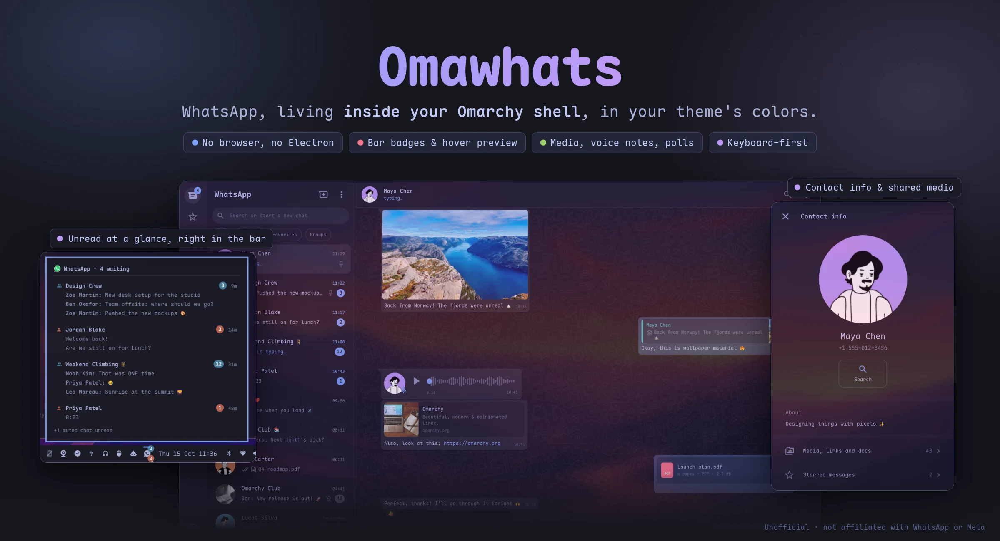
</p>

# Omawhats

WhatsApp inside the [Omarchy](https://omarchy.org) shell. A native QML window
laid out like WhatsApp Web and drawn in your current theme's colors, plus a
bar icon with unread badges, a hover preview and desktop notifications. It
links to your phone as one more device through a small Go bridge on
[whatsmeow](https://github.com/tulir/whatsmeow). No browser, no Electron.

## Install

```sh
omarchy plugin add https://github.com/leonavas/omawhats --enable
```

Click the bar icon, then on your phone go to **WhatsApp → Linked devices →
Link a device** and scan the QR code (or pick **Log in with phone number**).
Your phone doesn't need to stay online afterwards.

There's nothing else to set up. The first start builds the bridge from the
source in this repo, with Go fetched through `mise`, which ships with
Omarchy: about a minute and some 700 MB of downloads the first time (Go
itself and the bridge's modules, pinned by `go.sum`), and only a quick
rebuild after an update. Everything else it uses (`mpv`, `ffmpeg`,
`wl-clipboard`, `xdg-open`, `omarchy-file-select`) comes with Omarchy too.

Installed before 0.2.0, as `leonavas.whatsapp-claude`? Reinstall once instead
of updating; your settings and the session move over on their own:

```sh
omarchy plugin remove leonavas.whatsapp-claude && omarchy plugin add https://github.com/leonavas/omawhats --enable
```

## Screenshots

| | |
|---|---|
| 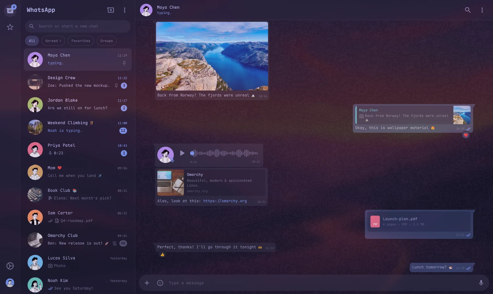 **Chats**: media, replies, voice notes, link previews, documents, reactions | 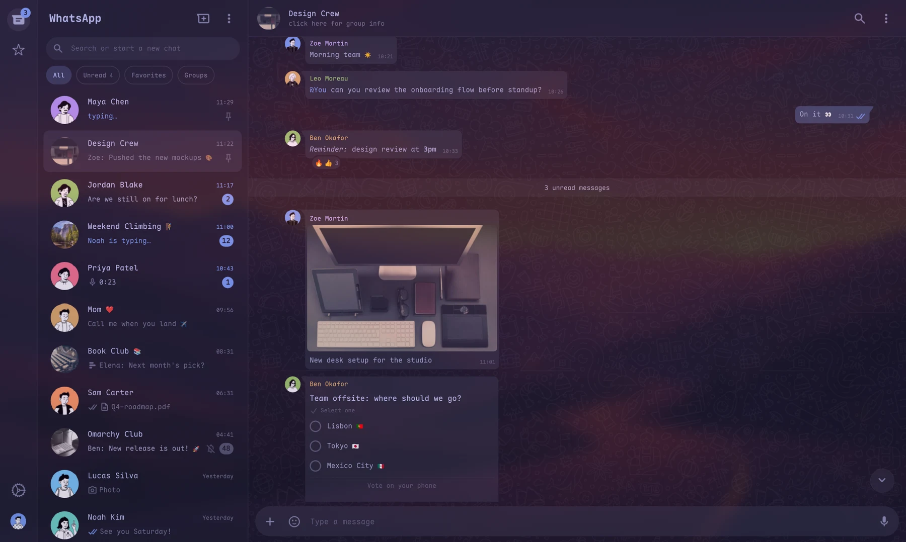 **Groups**: mentions, polls, the unread band |
| 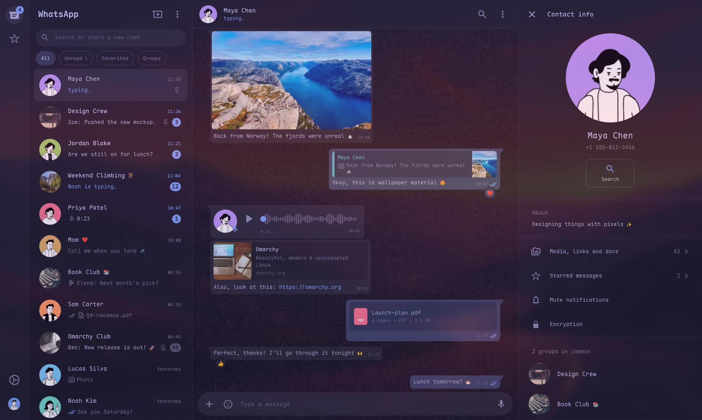 **Contact info**: about, groups in common, mute | 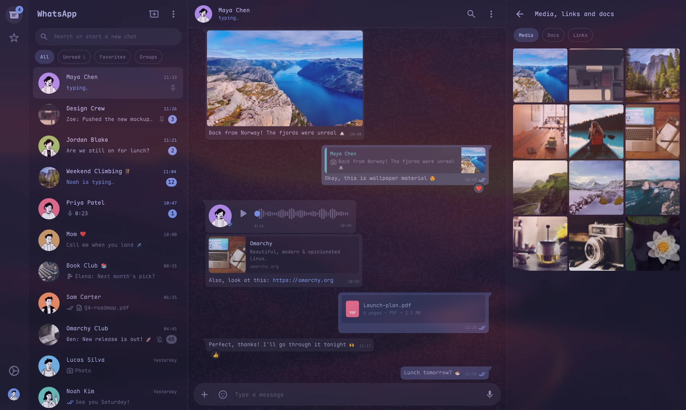 **Shared media**, docs and links |
| 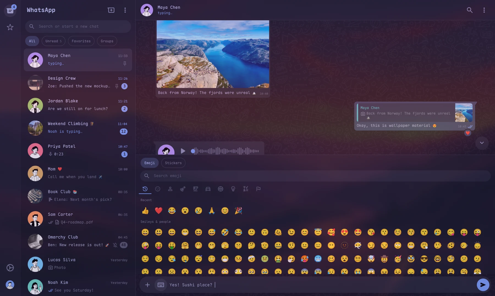 **Emoji and stickers** panel | 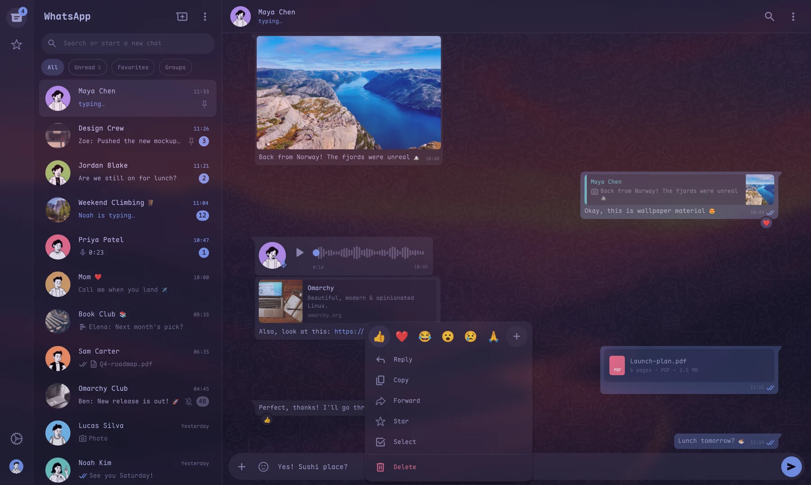 **Message actions** and quick reactions |
| 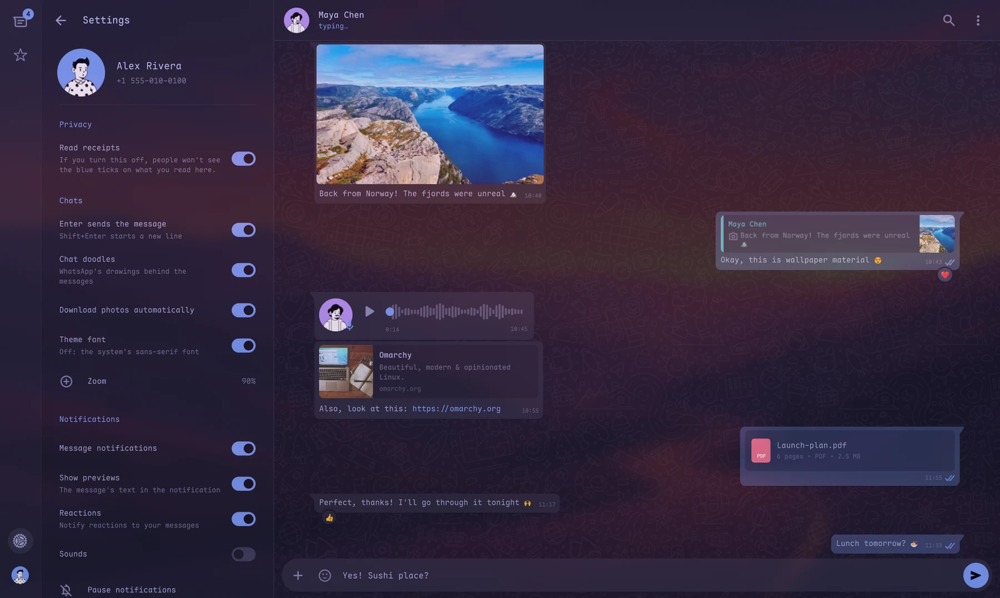 **Settings** | 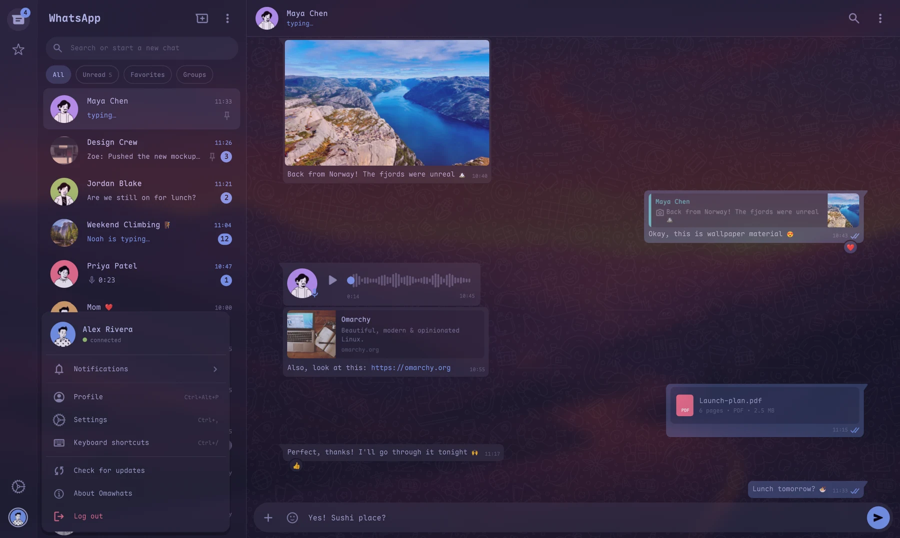 **Your menu** (Alt+S): profile, pause notifications, updates |
| 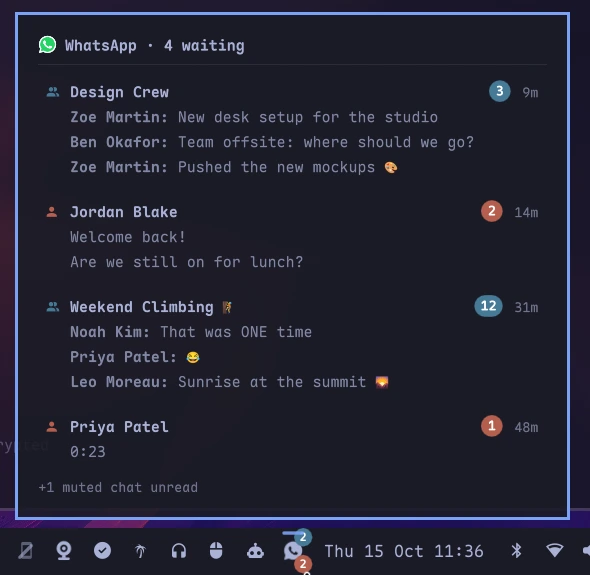 **The bar**: badges and a preview of what's unread | 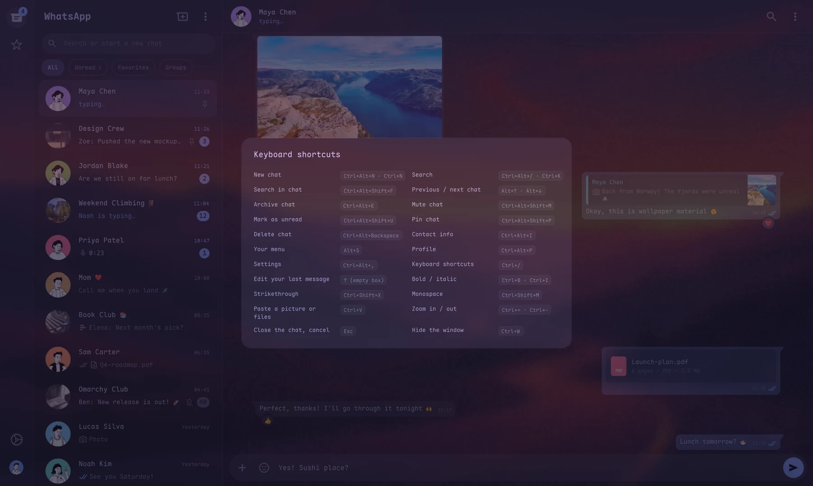 **Keyboard-first** (Ctrl+/) |

## Features

- Chats with WhatsApp Web's filters (All, Unread, Favorites, Groups),
  archived chats, pins, mutes, and search across chats and messages.
- History synced from the phone; older messages load as you scroll.
- Images, videos, GIFs, stickers, documents, voice notes (waveform, 1.5×/2×),
  locations, contacts, polls and events.
- Replies, reactions, edits, delete for everyone, forward, star; read
  receipts, typing and online status.
- A composer with formatting, emoji and stickers, attachments, pasted
  images, voice recording, mentions and drafts.
- Contact and group info, business profiles with opening hours, and your own
  profile (name, about, photo).
- English and Portuguese; zoom with Ctrl+= / Ctrl+-.

## The bar

- **Badges**: red for unread direct chats, blue for groups. Muted and
  archived chats count in neither. "Group notifications" folds them into one.
- **Hover** shows the unread chats with their newest messages; a click opens
  the chat.
- **Notifications** for new messages, except in muted chats, while paused, or
  for the chat on screen. Pause them for 30 minutes up to a chosen date.
- **Scratchpad parking**: the window lives in a special workspace (Omarchy's
  scratchpad by default). A click shows it, another puts it away, and
  WhatsApp keeps running.

Left click shows or hides the window, middle click quits WhatsApp, right
click opens the menu. Every option is in the widget's settings.

## Updates

Every six hours the app reads `manifest.json` on this repo's `main` branch
(a plain `curl`, nothing of yours is sent). When there's a new version, a
notice offers a one-click update (`omarchy plugin update`). Turn the check
off in Settings.

## Files

All of them only yours (folders `0700`, files `0600`):

- `~/.config/omawhats/settings.json`: settings and drafts.
- `~/.local/share/omawhats/`: the session, the message store, avatars,
  the built bridge and its log.
- `~/.cache/omawhats/`: downloaded media, and Go's module and build caches
  for the bridge (`go/`).
- Go itself, which `mise` keeps in `~/.local/share/mise/installs/go/`.

Log out from Settings (or unlink the device on your phone) to end the
session. Your messages only travel between your machine and WhatsApp.

## Remove

Log out first (Settings → Log out), so your phone drops the linked device;
otherwise remove it on the phone under **Linked devices**. Then:

```sh
omarchy plugin remove leonavas.omawhats
```

That removes the plugin and leaves your data. To remove the session,
messages, media and settings too:

```sh
rm -rf ~/.config/omawhats ~/.local/share/omawhats ~/.cache/omawhats
```

And the Go that `mise` fetched for the build, if nothing else of yours uses
it: `mise uninstall go@1.27`.

## Development

Link a clone of this repo into Omarchy's plugin folder, from the folder
that holds it:

```sh
ln -s "$PWD/omawhats" ~/.config/omarchy/plugins/leonavas.omawhats
omarchy-shell shell rescanPlugins
omarchy plugin enable leonavas.omawhats --section right
```

The shell caches plugin QML, so reload edits with `omarchy-restart-shell`.
IPC: `omarchy-shell omawhats toggle` (also `show`, `hide`,
`open <jid>`, `pause <minutes>`, `resume`, `status`).

## Disclaimer

Unofficial client, not affiliated with WhatsApp LLC or Meta Platforms, Inc.
WhatsApp's terms don't allow third-party clients: use it at your own risk.

Screenshots show made-up people and chats. Avatars are
[DiceBear Notionists](https://www.dicebear.com/styles/notionists/) (CC0);
photos are from [Unsplash](https://unsplash.com) via
[Lorem Picsum](https://picsum.photos).
